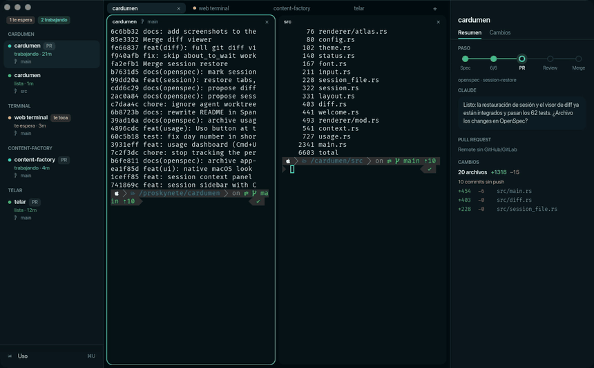
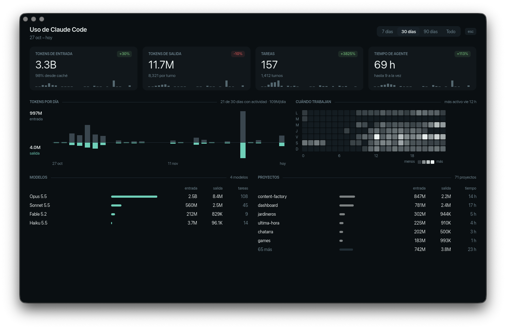

# Cardumen

Mi ADE personal para macOS: una terminal liviana, escrita en Rust, pensada para trabajar con varias sesiones de Claude Code en paralelo y saber en segundos en qué va cada una.



Un cardumen es un grupo de peces que nadan juntos. Así trabajo: 4 o 5 proyectos a la vez, cada uno con su sesión de Claude Code. Cardumen no trae IA propia; es el lugar donde esas sesiones viven.

## Por qué

Usé Warp durante años, pero cada vez pesaba más (cerca de 1 GB de RAM), traía telemetría y una IA que no necesito, porque Claude Code hace ese trabajo. Probé Orca y me gustó, pero quería algo hecho a la medida de cómo trabajo. Sí, es reinventar la rueda; pero es mi rueda.

## Qué hace

- **Terminal rápida**: render por GPU (Metal vía wgpu), emulación VT completa (`alacritty_terminal`), Nerd Fonts, tu `zsh` tal cual (`.zshrc`, prompt y plugins). Copiar al seleccionar.
- **Pestañas y paneles**: pestañas que se arrastran como en Warp, se renombran y se cierran con `×`; paneles divididos que se anidan.
- **Sesiones de Claude Code a la vista**: un sidebar agrupa los paneles por proyecto y muestra si cada sesión está *trabajando*, *te espera* o está *lista*, y desde hace cuánto. Si una te espera mientras estás en otra app, el ícono del Dock rebota.
- **Retomar una sesión en segundos**: el panel *Resumen* muestra en qué paso va (Spec → Tareas → PR → Review → Merge, leído de OpenSpec y del PR/MR), qué te pidió Claude o su último mensaje, el PR/MR (GitHub con `gh`, GitLab con `glab`) y qué cambió en el código.
- **Diff completo** de los cambios de la rama, con lista de archivos.
- **Uso de Claude Code**: tokens, tareas, tiempo de agente, tokens por día, cuándo trabajas y desglose por modelo y proyecto, leído de los transcripts locales.

  
- **Vuelve donde lo dejaste**: al abrirla recupera pestañas, nombres, paneles y carpetas.
- **Bienvenida con Tiburoncín** y la información de tu Mac.

## Liviana y privada

- ~45 MB de memoria con varias sesiones abiertas, 0% de CPU en reposo (Apple M1, 8 GB).
- `scripts/budget.sh` lo comprueba: abre Cardumen con 5 pestañas de prueba (sin tocar tu sesión) y falla si el primer frame pasa de 300 ms, la memoria de 60 MB o la CPU en reposo de 0.5%.
- Sin telemetría ni red. Lo único que sale de tu máquina son las consultas de PR/MR que hace `gh`/`glab`, cada 2 minutos por rama.
- El trabajo pesado (git, transcripts) corre en threads aparte; el panel de uso lee 3.6 GB de transcripts la primera vez (~5 s) y después solo lo nuevo (~30 ms).

## Instalación

Requiere macOS, Rust estable y, para la fuente por defecto, `FiraCode Nerd Font Mono` (si no está, usa Menlo).

```sh
brew install rustup gh            # glab en vez de (o además de) gh para GitLab
rustup default stable
git clone git@github.com:Proskynete/cardumen.git && cd cardumen
scripts/bundle.sh --install       # compila Cardumen.app y la instala en /Applications
scripts/install-hooks.py          # hooks de Claude Code para los estados del sidebar
gh auth login                     # o: glab auth login
```

`install-hooks.py` agrega hooks a `~/.claude/settings.json` (con respaldo, sin tocar los que ya tengas). Fuera de Cardumen no hacen nada.

Para desarrollo: `cargo run --release`.

## Atajos

| Teclas | Acción |
|--------|--------|
| Cmd+T / Cmd+W | nueva pestaña / cerrar panel |
| Cmd+D / Cmd+Shift+D | dividir a la derecha / hacia abajo |
| Cmd+Option+Flechas | mover el foco entre paneles |
| Cmd+1…8, Cmd+9 | ir a la pestaña 1–8, a la última |
| Cmd+Shift+[ / ], Ctrl+Tab | pestaña anterior / siguiente |
| Arrastrar, Cmd+Shift+←/→ | mover la pestaña |
| Doble clic, Cmd+Shift+R | renombrar la pestaña |
| Cmd+J | ir a la sesión que te espera (otra vez: la siguiente) |
| Cmd+P | ir a una pestaña escribiendo parte de su nombre o proyecto |
| Cmd+B | mostrar / ocultar el sidebar de sesiones |
| Cmd+I | mostrar / ocultar el panel Resumen |
| Cmd+G | ver el diff completo |
| Cmd+F | buscar en el panel (Enter: anterior, Shift+Enter: siguiente, Esc cierra) |
| Cmd+clic, Cmd+hover | abrir un link / previsualizar una imagen |
| Cmd+U | panel de uso (Esc cierra) |
| Cmd+C / Cmd+V | copiar / pegar (seleccionar también copia) |
| Cmd+= / Cmd+- / Cmd+0 | tamaño de fuente |
| Option+←/→, Cmd+←/→, Cmd+⌫ | palabra, inicio/fin de línea, borrar línea |

## Configuración

Opcional, en `~/.config/cardumen/config.toml`:

```toml
scrollback = 10000
welcome = true                 # Tiburoncín + info del hardware al abrir
# user_name = "Eduardo Álvarez" # por defecto, tu nombre en macOS
right_option_meta = false      # true: Option derecha = Meta; la izquierda sigue escribiendo @, [, ~…

[font]
family = "FiraCode Nerd Font Mono"
size = 14.0
```

## Cómo está hecho

Rust, `winit` + `wgpu` (Metal) con un renderer propio, `alacritty_terminal` para la emulación y `cosmic-text` para las fuentes. Sin webview.

Lo construí con Claude Code y spec-driven development: cada funcionalidad empezó como un change de [OpenSpec](https://github.com/Fission-AI/OpenSpec) (propuesta, diseño, specs y tareas) antes de escribir código. Las specs vigentes están en [`openspec/specs`](openspec/specs) y la historia de cada cambio en [`openspec/changes/archive`](openspec/changes/archive).
